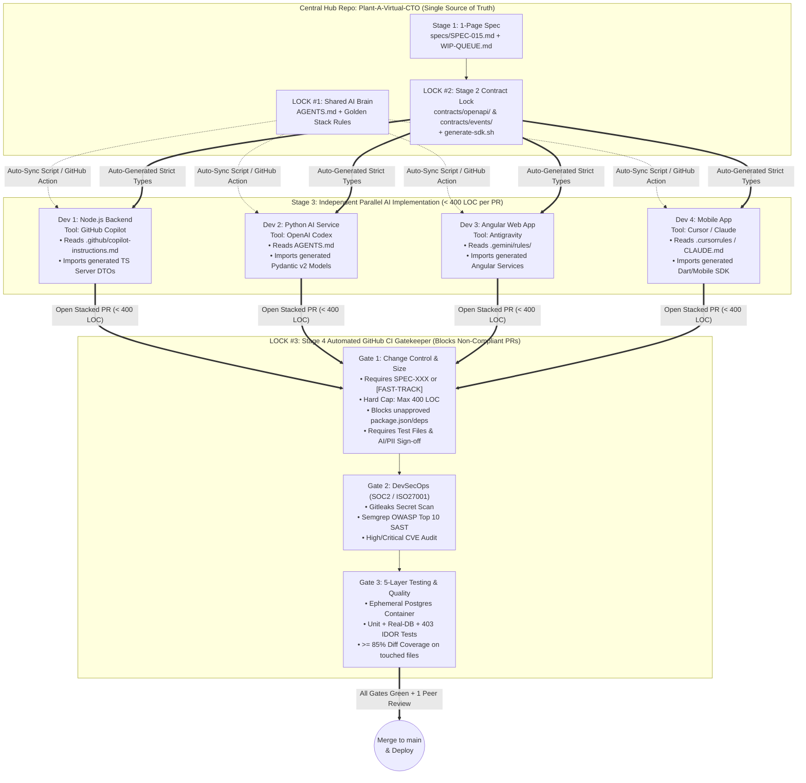
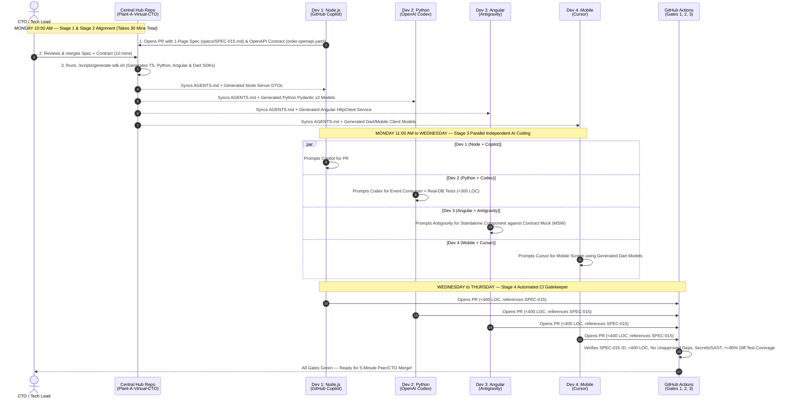
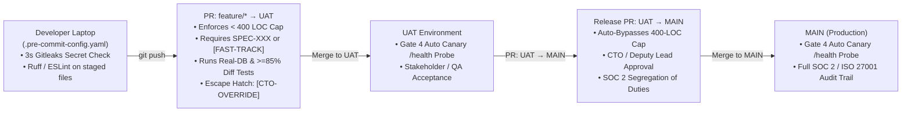
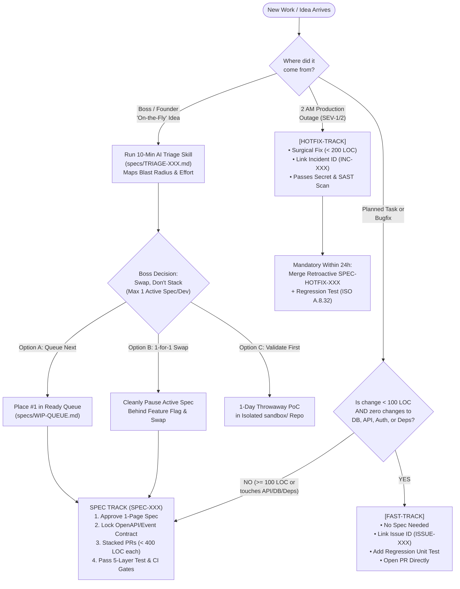
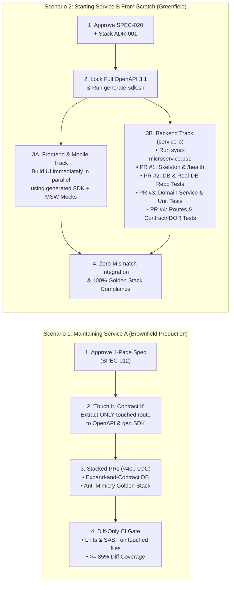
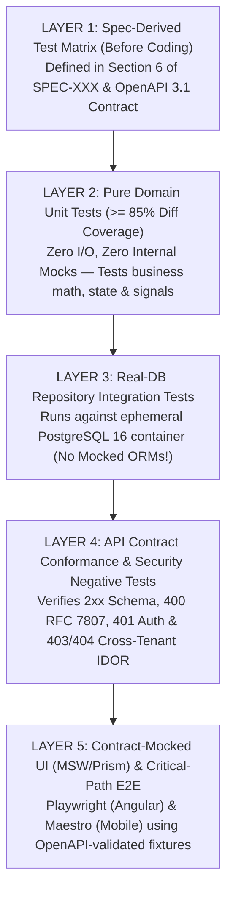
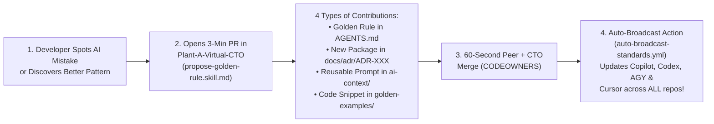
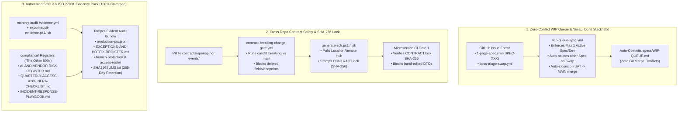

# Plant-A-Virtual-CTO: Complete Engineering Governance & Operational Playbook

> **Complete Operational Playbook for Multi-AI-Tool Microservice Teams**
> Maintaining Existing Production Services ("Service A"), Building New Services From Scratch ("Service B"), Multi-Developer Synchronization, Full-Fledged 5-Layer Testing, and SOC 2 / ISO 27001:2022 Compliance.

- **Methodology:** No-Agile / Spec-First & Automated Gate Flow
- **AI Tool Support:** GitHub Copilot, OpenAI Codex, Antigravity, Cursor, Claude Code
- **Golden Stack:** Node.js/TypeScript, Python (FastAPI), Angular, Mobile (Flutter/React Native)
- **Compliance:** SOC 2 (CC6, CC7, CC8) & ISO/IEC 27001:2022 (Annex A.8.25–A.8.32)

---

## 1. Executive Overview & Multi-Developer Synchronization Architecture

When developers work independently with their own choice of AI coding tools (GitHub Copilot, OpenAI Codex, Antigravity, Cursor, Claude Code), **code generation is no longer the bottleneck—alignment, contract consistency, and verification are.** Without a unifying framework, each AI tool invents conflicting architectural patterns, pulls in duplicate libraries, writes tautological mock tests, and produces massive, unreviewable Pull Requests.

Instead of Agile ceremonies (sprints, daily standups, story points), SDGE standardizes **inputs (AI context & 1-page specs)** and **outputs (locked contracts, 5-layer tests & automated CI security/quality gates)** across all repositories.

### Diagram 1: The 3 Synchronization Locks (How 4 Independent Developers & AI Tools Stay Aligned)



---

### 1.1 Multi-Repository Hub Topology (5+ Microservices)

A central `Plant-A-Virtual-CTO` repository acts as the single source of truth for AI context (`AGENTS.md`), feature specifications (`specs/`), API/Event contracts (`contracts/`), and reusable governance templates.

| Repository | Role | What Lives Inside |
| :--- | :--- | :--- |
| **`Plant-A-Virtual-CTO`** | **Central Governance & Contract Hub** | `AGENTS.md`, `specs/WIP-QUEUE.md`, `specs/SPEC-XXX.md`, `contracts/openapi/`, `contracts/events/`, `docs/adr/`, and sync scripts (`sync-microservice.ps1` / `.sh`). |
| **`service-a` (Brownfield)** | **Existing Production Microservice** | Synced copies of `AGENTS.md`, AI tool configs (`.github/copilot-instructions.md`, `.gemini/rules/`, `.cursorrules`, `CLAUDE.md`), `CODEOWNERS`, PR Template, and Diff-Only CI Gates. |
| **`service-b` (Greenfield)** | **New Microservice Built From Scratch** | Bootstrapped with `sync-microservice` on Day 1; 100% Golden Stack compliance, consuming generated OpenAPI/Event models from `Plant-A-Virtual-CTO`. |
| **`web-angular` & `mobile-app`** | **Client Applications** | Consume auto-generated TypeScript (Angular) and Dart/React-Native (Mobile) client SDKs generated from `contracts/openapi/`. |

> **Starting With a Personal GitHub Repository (Collaborator Mode):**
> You can host `Plant-A-Virtual-CTO` under your personal GitHub account and invite colleagues as Collaborators immediately. Because GitHub blocks private personal repos from cross-repo `workflow_call`, our sync script (`sync-microservice.ps1`) automatically injects a **self-contained CI workflow** directly into each microservice repo so all gates run out-of-the-box. Before your official SOC 2 / ISO 27001 audit window, transfer the repo to a GitHub Organization via *Settings → Transfer ownership* to satisfy centralized offboarding controls (SOC 2 CC6.2 / ISO A.5.18).

---

### 1.2 Concrete Walkthrough: How 4 Developers Synchronize From Monday to Friday

Imagine you have 4 developers working independently with 4 different AI tools on a feature called **"Order Refunds"**:
- **Dev 1 (Node.js `order-service`)** uses **GitHub Copilot**
- **Dev 2 (Python `billing-worker`)** uses **OpenAI Codex**
- **Dev 3 (Angular `web-portal`)** uses **Antigravity**
- **Dev 4 (Mobile `mobile-app`)** uses **Cursor**

#### Diagram 2: End-to-End Multi-Developer Synchronization Sequence (Monday to Friday)



---

## 2. The Three-Track Lifecycle & Managing "On-the-Fly" Ideas

Every Pull Request across every repository must declare one of three tracks (enforced automatically by CI Gate 1):

| Track | When to Use (Criteria) | Mandatory Process & Audit Trail |
| :--- | :--- | :--- |
| **`[FAST-TRACK]`**<br>**Fast Track** | `< 100 LOC` changed AND **zero** changes to dependencies, DB schemas, auth/security, or API/Event contracts. | Skip the 1-page Spec. Open PR directly referencing a bug/issue ID (e.g., `ISSUE-104`) + regression unit test. Passes automated CI + 1 human peer review. |
| **`SPEC-XXX`**<br>**Spec Track** | `>= 100 LOC` changed, any new feature, OR any change to dependencies, DB migrations, or API/Event contracts. | **Stage 1:** Approved 1-Page Spec (`SPEC-XXX`).<br>**Stage 2:** Merge OpenAPI/Event Contract PR first.<br>**Stage 3:** Stacked PRs (**max 400 LOC per PR** including tests).<br>**Stage 4:** CI Gates + Peer Review. |
| **`[HOTFIX-TRACK]`**<br>**Emergency Hotfix** | Critical production outage (SEV-1/SEV-2) or active security patch requiring immediate remediation. | Surgical diff (`< 200 LOC`) with Incident ID (`INC-XXX`). Bypasses pre-coding Spec, runs Secret/SAST scans, and requires a **retroactive `SPEC-HOTFIX-XXX` + regression test within 24 hours** (ISO 27001 A.8.32). |
| **`UAT → MAIN`**<br>**Release Promotion** | Promoting UAT-verified features from the `UAT` branch to Production (`MAIN`). | Automatically detected by CI (`HEAD=UAT`, `BASE=MAIN`). **Bypasses the 400-LOC cap** (since releases bundle multiple features), runs SAST/CVE/Test checks, and triggers **Gate 4 Post-Deploy Canary/Smoke Test**. |
| **`[CTO-OVERRIDE: reason]`**<br>**Startup Escape Hatch** | Urgent startup delivery where splitting a >400 LOC PR or waiting on a pre-Spec would harm the business. | CTO or Deputy Lead (`@deputy-lead-handle` in `CODEOWNERS`) adds `[CTO-OVERRIDE: <reason>]` to the PR. **Waives soft gates** (400-LOC cap / pre-Spec) while logging an **Authorized Compliance Exception** for SOC 2 / ISO 27001 audit trails. |

### 2.0.1 Branch Promotion Flow (`feature/* → UAT → MAIN`) & Local Pre-Commit Guardrails



### Diagram 3: Work Intake, 3-Track Routing & Boss "On-the-Fly" Triage Decision Tree



---

## 3. Scenario 1: Maintaining "Service A" (Existing Production Service)

**Context:** `Service A` is already live in production. It contains legacy code written with different AI tools, existing database tables, and undocumented REST endpoints.

> **The Golden Rule for Brownfield Services:** Do **not** freeze feature work to rewrite `Service A` or write OpenAPI contracts for all 50+ existing endpoints at once. Onboard `Service A` in 5 minutes and apply the **"Touch It, Standardize It"** rule.

### Step 0: One-Time Onboarding of `Service A` (Takes 5 Minutes)

Clone `Plant-A-Virtual-CTO` and `service-a` side-by-side and run the sync script:

```powershell
# Windows PowerShell (set -Stack to "node", "python", "angular", or "mobile")
.\scripts\sync-microservice.ps1 -TargetRepoPath "..\service-a" -Stack "node"

# macOS / Linux / Git Bash
./scripts/sync-microservice.sh ../service-a node
```

**What this does to `Service A` without breaking existing code:**
* Installs `AGENTS.md`, `.github/copilot-instructions.md`, `.gemini/rules/Plant-A-Virtual-CTO.md`, `.cursorrules`, and `CLAUDE.md` so every developer's AI tool immediately stops copying legacy anti-patterns.
* Installs `.github/CODEOWNERS` (locking `package.json` / `pyproject.toml`, DB migrations, and contracts to CTO review).
* Installs `.github/workflows/ci-gates.yml` configured in **Brownfield Safe Mode (Diff-Only Linting, SAST & Diff-Coverage >= 85%)**—it only checks files modified in the PR (`git diff origin/main...HEAD`), so untouched legacy files never cause CI failures.

### Case 1A: Fixing a Small Bug or Tweak in `Service A` (`< 100 LOC`)
*Example: Fixing a timezone calculation bug or null pointer in an existing service method.*

1. **Track:** Qualifies for `[FAST-TRACK]` (`< 100 LOC`, no DB/Contract/Dependency changes). No Spec file needed.
2. **Prompt Your AI Tool in `service-a`:**
   ```text
   Read AGENTS.md. Fix the bug in src/services/billing.service.ts where [describe bug].
   Strict constraints:
   1. Do NOT reformat or refactor unrelated functions in this legacy file.
   2. Do NOT add any new packages to package.json / pyproject.toml.
   3. Follow the Golden Stack rules in AGENTS.md for the lines you touch and add a regression unit test.
   4. Keep the total git diff under 100 lines.
   ```
3. **Open PR:** Select `[x] Fast Track ([FAST-TRACK])` in the PR template, add your issue ID (`ISSUE-108`), check the AI & SOC 2 verification boxes, and merge after 1 peer review.

### Case 1B: Adding a Feature or Modifying an Existing Endpoint in `Service A`
*Example: Adding discount code support to an existing production endpoint `POST /v1/orders` in `Service A`.*

#### Stage 1 — Draft & Approve a 1-Page Spec (10 Minutes)
In `Plant-A-Virtual-CTO`, prompt your AI assistant to create `specs/SPEC-012-order-discounts.md`:
```text
Read AGENTS.md and specs/TEMPLATE-1PAGE-SPEC.md. Draft specs/SPEC-012-order-discounts.md to add optional discountCode support to POST /v1/orders in service-a. Include backward-compatibility rules for live Angular/Mobile clients, Expand-and-Contract DB migration steps, SOC 2 tenant isolation checks, the Mandatory Test Matrix (Section 6), and a breakdown of stacked PRs under 400 LOC each.
```

#### Stage 2 — "Touch It, Contract It" (Extract Baseline & Lock Contract First)
Because `POST /v1/orders` is an existing legacy endpoint that wasn't in OpenAPI yet, extract **only that endpoint** into `contracts/openapi/service-a.openapi.yaml` using the brownfield extraction skill:
```text
Follow ai-context/reverse-engineer-contract.skill.md. Read src/controllers/orders.controller.ts in service-a, extract the current production request/response schema for POST /v1/orders into contracts/openapi/service-a.openapi.yaml, and add the new optional discountCode field in a backward-compatible way.
```
Merge the contract PR and run `./scripts/generate-sdk.sh contracts/openapi/service-a.openapi.yaml service-a`.

#### Stage 3 — Implement in Stacked PRs (`< 400 LOC` Each Including Tests) in `Service A`
* **PR #1 (`SPEC-012` — DB Migration, Repository & Real-DB Tests, `~220 LOC`):** Adds a **nullable** column (Expand-and-Contract pattern so live production instances don't break during rollout) + repository query + real-DB integration test.
* **PR #2 (`SPEC-012` — Service, Controller & Contract/IDOR Tests, `~260 LOC`):** Implements discount validation in the service layer, wires the controller using generated OpenAPI DTOs, and adds HTTP contract + 403 IDOR tests.

---

## 4. Scenario 2: Starting "Service B" From Scratch (Greenfield Service)

**Context:** You are launching a brand-new microservice (`Service B`, e.g., a Python FastAPI service or Node.js NestJS/Fastify service). Starting from scratch with SDGE allows your backend, Angular, and Mobile developers to work **100% in parallel** with zero integration mismatches.

### Diagram 4: Maintaining "Service A" (Brownfield) vs. Building "Service B" (Greenfield)



### Step 1: Approve the 1-Page Spec (`SPEC-020`) & Architecture Decision (`ADR-XXX`)
1. Draft `specs/SPEC-020-service-b.md` in `Plant-A-Virtual-CTO` defining the service boundaries, data ownership, security/PII classification, Section 6 Test Matrix, and 4-PR breakdown.
2. Choose one of your approved Golden Stacks (e.g., **Node.js + NestJS/Fastify + Prisma** OR **Python 3.11 + FastAPI + Pydantic v2 + SQLAlchemy 2.0**).
3. Because initializing a new repo adds a base `package.json` or `pyproject.toml`, create a 20-line `docs/adr/ADR-001-service-b-stack.md` listing the approved core dependencies so Gate 1 CI permits PR #1's manifest.

### Step 2: Lock `Service B`'s Contracts & Generate Multi-Language SDKs
1. Create `contracts/openapi/service-b.openapi.yaml` (and `contracts/events/` schemas if event-driven) in `Plant-A-Virtual-CTO`.
2. Run the SDK generator script to produce strongly-typed clients for every platform:
   ```bash
   ./scripts/generate-sdk.sh contracts/openapi/service-b.openapi.yaml service-b
   # Outputs:
   #   generated/service-b/typescript-node/schema.d.ts   (Node.js & React Native)
   #   generated/service-b/angular-client/               (Angular Injectable Services & Models)
   #   generated/service-b/python-pydantic/models.py     (Python FastAPI Pydantic v2 Models)
   #   generated/service-b/mobile-client/                (Dart / Flutter Models)
   ```

### Step 3: Create the `service-b` Repo & Run the Sync Script (2 Minutes)
Create the empty `service-b` repository on GitHub, clone it locally, and inject all AI rules and CI gates before writing any code:
```powershell
.\scripts\sync-microservice.ps1 -TargetRepoPath "..\service-b" -Stack "python"
```

### Step 4: Build `Service B` in 4 Bounded Stacked PRs (`< 400 LOC` Each)
Instead of prompting an AI tool to generate a 2,500-line microservice in one giant unreviewable commit, use these four sequential prompts:

* **PR #1 Prompt — Skeleton, Config & RFC 7807 Error Handler (`~200 LOC`):**
  ```text
  Read AGENTS.md and specs/SPEC-020-service-b.md. Implement ONLY PR #1 (Service Skeleton):
  1. Set up folder structure (controllers/, services/, repositories/, config/, tests/).
  2. Configure strict startup environment validation, structured logging (redacting auth/PII), global RFC 7807 ProblemDetails exception handler, GET /health, and healthcheck test.
  3. Reference SPEC-020 and ADR-001. Keep non-lockfile diff under 250 LOC.
  ```
* **PR #2 Prompt — Database Schema, Migrations & Real-DB Repository Tests (`~250 LOC`):**
  ```text
  Read AGENTS.md and specs/SPEC-020-service-b.md. Implement ONLY PR #2 (Persistence Layer):
  1. Create the initial DB migration and typed ORM models (Prisma / SQLAlchemy 2.0 Async).
  2. Implement the repositories/ data-access class with parameterized queries and real-DB integration tests (do not mock the ORM).
  3. Do NOT add HTTP controllers or domain logic in this PR. Keep diff under 300 LOC.
  ```
* **PR #3 Prompt — Domain Business Logic & Edge-Case Unit Tests (`~250 LOC`):**
  ```text
  Read AGENTS.md and specs/SPEC-020-service-b.md. Implement ONLY PR #3 (Domain Service Layer):
  1. Implement business logic in services/ using the repository interfaces from PR #2.
  2. Add unit tests covering all failure modes and edge cases in Section 6 of SPEC-020 (>= 85% diff coverage).
  3. Keep diff under 300 LOC.
  ```
* **PR #4 Prompt — API Controllers, Auth Guards & Contract/IDOR Tests (`~250 LOC`):**
  ```text
  Read AGENTS.md and contracts/openapi/service-b.openapi.yaml. Implement ONLY PR #4 (Transport & Verification):
  1. Wire the HTTP routes/controllers importing the generated contract DTOs (do not hand-write duplicate DTOs).
  2. Enforce authentication and tenant-isolation authorization guards.
  3. Write contract integration tests verifying 200/201 schema conformance, 400 RFC 7807 validation, 401 unauthenticated, and 403/404 cross-tenant IDOR rejection. Keep diff under 300 LOC.
  ```

### Side-by-Side Summary: Maintaining `Service A` vs. Starting `Service B`

| Lifecycle Dimension | Maintaining `Service A` (Existing Brownfield) | Starting `Service B` (New Greenfield) |
| :--- | :--- | :--- |
| **Initial Onboarding** | Run `sync-microservice.ps1` (5 mins; zero existing code broken) | Create repo + run `sync-microservice.ps1` before writing code |
| **Small Fixes (`< 100 LOC`)** | **Fast Track (`[FAST-TRACK]`)** — straight to PR + regression test | **Fast Track (`[FAST-TRACK]`)** — straight to PR + regression test |
| **Features / API Changes** | **Spec Track (`SPEC-XXX`)** + **"Touch It, Contract It"** extraction | **Spec Track (`SPEC-XXX`)** + 100% OpenAPI locked before PR #1 |
| **CI Linting, SAST & Tests** | **Diff-Only** (`>= 85%` diff coverage & lint on modified files) | **100% Golden Stack & `>= 85%` Coverage** from Commit #1 |
| **Database Migrations** | **Expand-and-Contract** (zero-downtime backward-compatible) | Clean initial migration in PR #2 |

---

## 5. Full-Fledged 5-Layer Testing Architecture (Anti-AI-Hallucination)

When developers ask AI tools to *"Write unit tests"* after writing code, AI defaults to the **"AI Mock Trap"**—mocking the ORM/functions it just wrote and asserting the mock returns itself (giving 95% coverage that catches 0% of real bugs).

### Diagram 5: The 5-Layer Testing Trophy & CI Verification Pipeline



| Test Layer | What It Verifies | Key Rule Enforced in `AGENTS.md` |
| :--- | :--- | :--- |
| **Layer 1: Spec-Derived Test Matrix** | Acceptance criteria, edge cases, and failure modes in Section 6 of `SPEC-XXX`. | Generate tests from `SPEC-XXX` and `contracts/openapi/`, never by summarizing implementation code. |
| **Layer 2: Pure Domain Unit Tests** | Business calculations, state transitions, validators, Angular Signals/pipes (`>= 85%` diff coverage). | **Anti-Mock Rule:** Never mock internal domain classes or the unit under test; only mock external 3rd-party APIs/clock. |
| **Layer 3: Real-DB Integration Tests** | Prisma / Drizzle / SQLAlchemy 2.0 queries, migrations, constraints, and transactions. | **No Mocked ORMs:** Run against an ephemeral Postgres container (`Testcontainers` / CI service container). |
| **Layer 4: Contract & IDOR Security Tests** | 2xx OpenAPI schema match, 400 RFC 7807 validation, 401 Auth, and **403/404 Cross-Tenant IDOR prevention**. | Every endpoint test must prove `Tenant A` cannot read or mutate `Tenant B`'s resources (SOC 2 CC6.1 / ISO A.8.29). |
| **Layer 5: Contract-Mocked UI & E2E** | Angular & Mobile UI integration (via MSW/Prism OpenAPI mocks) + Playwright/Maestro critical paths. | Never hand-invent fake JSON fixtures in frontend/mobile tests; mock directly from `contracts/openapi/`. |

---

## 6. Golden Stack & Banned Patterns Summary (`AGENTS.md`)

| Stack | Mandatory Golden Stack Standards | Explicitly Banned Patterns (Blocked in Review/CI) |
| :--- | :--- | :--- |
| **Node.js / TypeScript** | Node LTS, TypeScript (`strict: true`, `noImplicitAny: true`), NestJS or Fastify, Prisma/Drizzle ORM, Zod validation, Vitest/Jest + Supertest + Testcontainers. | ❌ `any` or `@ts-ignore`<br>❌ `axios` or `request` (use native `fetch` / internal client)<br>❌ `moment.js`<br>❌ Direct ORM calls inside Controllers or mocked ORMs in repo tests |
| **Python Services** | Python 3.11+, FastAPI, Pydantic v2 (`model_validate`, `extra="forbid"`), SQLAlchemy 2.0 Async + Alembic, `ruff`, `mypy --strict`, `pytest` + `schemathesis`. | ❌ Untyped function signatures<br>❌ Pydantic v1 `.dict()` or `.parse_obj()`<br>❌ Sync `requests.get` or `time.sleep` inside `async def`<br>❌ Bare `except: pass` |
| **Angular Frontend** | Standalone Components (`standalone: true`), Angular Signals (`signal`, `computed`), `ChangeDetectionStrategy.OnPush`, OpenAPI-generated services, MSW + Playwright. | ❌ Legacy `NgModule` for new features<br>❌ Hand-written duplicate backend interfaces or fake JSON mocks<br>❌ Function calls inside HTML templates<br>❌ Unsubscribed observables (use `takeUntilDestroyed`) |
| **Mobile Apps** | OpenAPI-generated Dart/TS client models, clean `Presentation → Domain → Data` separation, hardware-backed secure storage (`Keychain` / `EncryptedSharedPreferences`), Maestro E2E. | ❌ Direct HTTP calls or business logic inside UI Widgets/Screens<br>❌ Storing tokens in plain `SharedPreferences` / `AsyncStorage`<br>❌ Mixing multiple state management libraries |

### 6.1 How Developers Contribute to Golden Rules & Shared AI Memory ("Compound Engineering")

`AGENTS.md` is not a static top-down rulebook—it is the team's **Compound AI Memory**. Whenever a developer catches their AI tool (Copilot, Codex, Antigravity, Cursor) making a recurring mistake, or when two developers agree on a better pattern during PR review, they contribute it back to `Plant-A-Virtual-CTO` so **every developer's AI tool immediately learns the lesson.**

#### Diagram 6: The Developer-Driven "Compound AI Memory" Contribution Loop



* **Prompt for Any Developer to Propose a Rule in 2 Minutes (`ai-context/propose-golden-rule.skill.md`):**
  > *"Follow `ai-context/propose-golden-rule.skill.md`. My AI tool just made mistake [X] (or we want to adopt pattern/library [Y]). Draft a concise 2-line addition to `AGENTS.md` (and a 20-line `docs/adr/ADR-XXX.md` if adding a package) ready for a PR."*

---

## 7. SOC 2 & ISO/IEC 27001:2022 Automated Control Matrix

| Compliance Control | Control Objective | Automated Enforcement & Audit Artifact in SDGE |
| :--- | :--- | :--- |
| **SOC 2 CC8.1**<br>**ISO 27001 A.8.32** | Change Management & Authorization | **CI Gate 1 (`change-control-gate`)** blocks any PR without a valid `SPEC-XXX`, `[FAST-TRACK]` Issue ID, or `[HOTFIX-TRACK]` Incident ID. Branch protection requires human peer review (Segregation of Duties). |
| **ISO 27001 A.8.25 & A.8.28** | Secure SDLC & Secure Coding | Codified in `AGENTS.md` and automatically loaded into Copilot, Antigravity, Codex, Cursor, and Claude. Enforces parameterized queries, input validation, and RFC 7807 error masking. |
| **ISO 27001 A.8.26** | Application Security Requirements | Section 5 & 6 of `specs/TEMPLATE-1PAGE-SPEC.md` mandate explicit sign-off on Authentication, Tenant Isolation (IDOR prevention), PII handling, Test Matrix, and Rollback Plan prior to coding. |
| **ISO 27001 A.8.29**<br>**SOC 2 CC7.1** | Security & Functional Testing in Development | **CI Gate 1** blocks code PRs missing test files. **CI Gate 2** runs **Gitleaks** (secrets), **Semgrep** (OWASP Top 10 SAST), and **CVE audits**. **CI Gate 3** runs unit + real-DB integration tests (`>= 85%` diff coverage). |
| **ISO 27001 A.5.12**<br>**SOC 2 Confidentiality** | AI Data Privacy & Protection of PII/Secrets | CI Gate 1 enforces mandatory PR checkbox attestation: *"`[x]` No production secrets, customer PII, or proprietary credentials were shared with external AI tools or committed."* |


---

## 8. Enterprise Hardening: Zero-Conflict WIP Sync, Contract Safety & Full Audit Pack

To ensure **`Plant-A-Virtual-CTO`** rivals commercial governance platforms without recurring SaaS costs, the repository includes three automated hardening subsystems:

#### Diagram 7: Enterprise Hardening Architecture (WIP Bot, Contract Lock & Audit Exporter)



### 8.1 Zero-Conflict WIP Queue & Automatic "Swap, Don't Stack" Enforcement
Manual edits to a shared Markdown table (`specs/WIP-QUEUE.md`) on feature branches cause Git merge conflicts and go stale when developers forget to update them.
* **GitHub Issue Forms ([`.github/ISSUE_TEMPLATE/1-page-spec.yml`](../.github/ISSUE_TEMPLATE/1-page-spec.yml) & [`boss-triage-swap.yml`](../.github/ISSUE_TEMPLATE/boss-triage-swap.yml)):** Developers create or swap Specs via structured GitHub Issues (or via CLI: `gh issue create --template "1-page-spec.yml" --label "spec,status:active" --assignee "@me"`).
* **Automated Bot Enforcement ([`.github/workflows/wip-queue-sync.yml`](../.github/workflows/wip-queue-sync.yml)):**
  1. **Enforces Max 1 Active Spec/Dev:** When a developer assigns themselves a new `status:active` Issue, the GitHub Action automatically transitions any older `status:active` Issue owned by that developer to `status:paused` and comments on the thread.
  2. **Auto-Transitions on PR Merge:** Merging a PR referencing `SPEC-XXX` into `UAT` automatically flips the Issue to `status:uat`; merging into `MAIN` automatically closes the Issue as `status:done`.
  3. **Rebuilds `specs/WIP-QUEUE.md` on `main`:** Only the bot commits to `specs/WIP-QUEUE.md`, guaranteeing zero merge conflicts and an always-accurate file for local AI tools.

### 8.2 Cross-Repo Contract Safety (`oasdiff` Breaking Gate + `CONTRACT.lock`)
* **Automated Breaking-Change Blocker ([`.github/workflows/contract-breaking-change-gate.yml`](../.github/workflows/contract-breaking-change-gate.yml)):**
  * Runs **`oasdiff breaking`** on every PR touching `contracts/openapi/*.yaml` and checks JSON Schema property compatibility on `contracts/events/*.json`.
  * Deleting an endpoint, renaming a response field, or adding a required request parameter without bumping `/v2` **fails CI immediately** (unless overridden via `[CTO-OVERRIDE: reason]`), protecting live Mobile and Angular clients.
* **Remote Hub Fetch & Cryptographic `CONTRACT.lock` ([`scripts/generate-sdk.ps1`](../scripts/generate-sdk.ps1) & [`scripts/generate-sdk.sh`](../scripts/generate-sdk.sh)):**
  * Developers can generate SDKs either from a local checkout or directly from the remote GitHub repository (`-RemoteHubUrl`), removing fragile relative-path assumptions.
  * Stamps a `CONTRACT.lock` file containing the SHA-256 hash of all generated DTOs (`sdk_output_sha256`).
  * **Gate 1 CI (`reusable-sdge-gates.yml`)** verifies `CONTRACT.lock` on every PR—blocking any developer or AI tool that manually edits generated files in `src/generated/contracts/`.

### 8.3 Automated SOC 2 / ISO 27001 Evidence Exporter & "The Other 80%" Compliance Pack
* **1-Click & Monthly Tamper-Evident Evidence Bundle ([`scripts/export-audit-evidence.ps1`](../scripts/export-audit-evidence.ps1) & [`.github/workflows/monthly-audit-evidence.yml`](../.github/workflows/monthly-audit-evidence.yml)):**
  * Queries GitHub's API across all repositories and exports `*-production-prs.json`, `EXCEPTIONS-AND-HOTFIX-REGISTER.md` (every `[CTO-OVERRIDE]` and `[HOTFIX-TRACK]`), `*-branch-protection.json`, `*-access-roster.json`, and a cryptographic `SHA256SUMS.txt` manifest.
* **Beyond-GitHub Audit Registers ([`compliance/`](../compliance/)):**
  * [`compliance/AI-AND-VENDOR-RISK-REGISTER.md`](../compliance/AI-AND-VENDOR-RISK-REGISTER.md): Mandatory **Zero-Training / Privacy Mode** settings across GitHub Copilot, OpenAI Codex, Antigravity, Cursor, and Claude Code.
  * [`compliance/QUARTERLY-ACCESS-AND-INFRA-CHECKLIST.md`](../compliance/QUARTERLY-ACCESS-AND-INFRA-CHECKLIST.md): Cloud IAM MFA, AES-256 DB encryption, quarterly DB backup restore log, developer laptop BitLocker/FileVault encryption, and 24-hour offboarding SLA.
  * [`compliance/INCIDENT-RESPONSE-PLAYBOOK.md`](../compliance/INCIDENT-RESPONSE-PLAYBOOK.md): `SEV-1/2/3` SLAs, 30-minute leaked-secret rotation procedure, and annual Tabletop Exercise log.


### 8.4 Hub Self-Governance (Tier-0 Protection for `Plant-A-Virtual-CTO` Itself)
Because `Plant-A-Virtual-CTO` broadcasts CI workflows (`reusable-sdge-gates.yml`), security rules (`AGENTS.md`), and contracts to all production repositories, the hub repository itself is protected as **Tier-0 Critical Infrastructure**:
* **Hub-Level [`.github/CODEOWNERS`](../.github/CODEOWNERS):** Locks `/.github/workflows/`, `/AGENTS.md`, `/scripts/`, `/contracts/`, `/compliance/`, and `/microservice-template/` to `@cto-handle @deputy-lead-handle` so no developer can weaken a CI gate or modify a contract without CTO/Deputy approval.
* **Self-Governance CI ([`.github/workflows/hub-self-governance-ci.yml`](../.github/workflows/hub-self-governance-ci.yml)):** Runs on every Pull Request to `Plant-A-Virtual-CTO`, enforcing **Gitleaks** secret scanning, PR template sign-off attestation, Bash/YAML/JSON syntax verification (`bash -n`, `jq`, `pyyaml`), and clean UTF-8 encoding checks.
* **Supply-Chain Pinned Tooling & [`SECURITY.md`](../SECURITY.md):** All CI binaries (such as `oasdiff v1.11.7` in `contract-breaking-change-gate.yml`) are version-pinned rather than piped from mutable branches, and [`SECURITY.md`](../SECURITY.md) enforces a 90-day rotation policy on fine-grained `ORG_SYNC_PAT` tokens.
